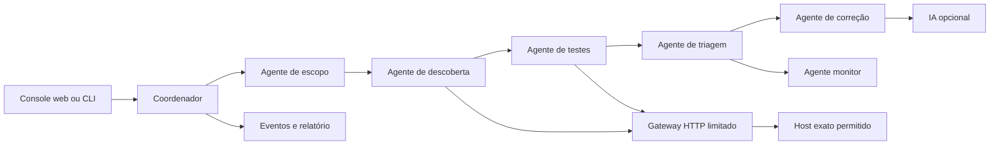

# Pentest com agentes — Hackathon Hubbits, Desafio 3

Pipeline funcional e limitada para observar a aplicação em `https://4.migbot.com.br/#/`, registrar evidências, classificar achados, sugerir correções e detectar regressões. O escopo é declarado em [`scope.json`](scope.json). A campanha padrão faz **seis GETs planejados**, com intervalo mínimo de 1 segundo e limite absoluto de oito requisições. O `#/` é rota de navegador; a requisição HTTP inicial usa `/`.

## Executar

Requer Python 3.11 ou superior; não há dependências Python obrigatórias.

```bash
python3 -m pentest_pipeline scan --config scope.json
python3 -m pentest_pipeline monitor --config scope.json --baseline reports/baseline.json
python3 -m pentest_pipeline.web_server
python3 -m unittest discover -s tests -v
```

O comando `scan` grava `evidence.json` e `report.md` em `reports/<run_id>/`. `monitor` cria o baseline na primeira execução e, nas seguintes, grava `diff.json` com achados novos, resolvidos, alterados e estáveis. Retorna código 2 quando há achado novo ou alterado; execução incompleta não é comparada nem substitui o baseline. Use `--update-baseline` somente depois de revisar o diff. `Ctrl+C` solicita parada; o evento de parada fica na trilha de auditoria.
O monitor compara apenas execuções com o mesmo alvo, configuração de escopo e hash das regras de teste. Uma mudança no detector exige novo baseline revisado; não é interpretada como mudança no alvo.

A interface web local abre com `python3 -m pentest_pipeline.web_server`. Consulte a URL impressa pelo servidor e use os controles de iniciar, acompanhar e parar a campanha.
Para usar o agente de IA também no console, defina `OPENAI_API_KEY` no ambiente e inicie o servidor com `python3 -m pentest_pipeline.web_server --ai`. O console não ativa chamadas externas de IA por padrão.

### Orientação opcional por IA

```bash
export OPENAI_API_KEY="..."
export PENTEST_AI_MODEL="gpt-6-luna"  # opcional; este é o padrão
python3 -m pentest_pipeline scan --config scope.json --ai
```

O `OpenAIAdvisor` usa a [Responses API](https://developers.openai.com/api/docs/guides/migrate-to-responses?api-mode=responses) uma única vez, depois dos testes, com `store: false` e saída JSON estruturada. Envia apenas IDs, classificações e evidências resumidas dos cinco primeiros achados; não envia corpos de resposta, valores de cookies ou arquivos. O modelo não recebe ferramentas de rede. Respostas de IA entram como **dicas para revisão humana** e não alteram o status dos achados. Se a chamada falhar, as orientações determinísticas permanecem e o relatório registra a falha sem expor a chave. Nunca grave a chave em arquivos do projeto; `.env` e `reports/` são ignorados pelo Git.

## Agentes e dados



| Agente | Trabalho executável |
| --- | --- |
| Escopo | Valida host, esquema, porta, método, caminhos, ritmo e orçamento antes da campanha. |
| Descoberta | Lê a página inicial e conta desafios de dificuldades 1 e 2 em `/api/Challenges`; guarda somente nomes dos tutoriais iniciais. |
| Testes | Confere cabeçalhos e cookies; lê somente índices de `/ftp/`, formato de `/metrics` e compara `q=apple` com `q=apple%27` na busca. |
| Triagem | Deduplica e atribui severidade, estado e confiança a cada evidência. |
| Correção | Anexa dicas condicionais de configuração e código; não presume acesso ao repositório da aplicação. |
| Monitor | Compara duas execuções completas por identificador estável de achado. |

O site alvo é uma SPA; os arquivos desta pasta implementam o **avaliador**, não o código da aplicação avaliada. Por isso, as sugestões Express/SQLite são exemplos baseados no erro observado e precisam ser adaptadas ao servidor real.

## Modelo de segurança

- O transporte central aceita apenas `GET` e `HEAD`, valida host exato, HTTPS e porta, bloqueia endereços privados por padrão e **não segue redirecionamentos**. Scripts de outros hosts são recusados. A campanha padrão não baixa arquivos listados em `/ftp/`.
- A fila contém somente os seis caminhos declarados. Não há força bruta, exploração SQL, injeção adicional, exfiltração, alteração de estado ou aumento automático de profundidade. Credenciais privilegiadas e ações ativas exigem aprovação humana e implementação específica.
- O limite de requisições, o intervalo, o timeout e o teto de corpo estão em `scope.json`. Corpos são analisados em memória e descartados; o log guarda status, metadados limitados e hash SHA-256. URLs são registradas sem query e valores de cookies não são persistidos. A evidência cita somente os dois valores sintéticos usados no teste de busca.
- Cada decisão, requisição, resposta, teste, classificação, orientação e parada produz evento com horário UTC. Estados dos achados: `confirmed` para observação reproduzida, `inconclusive` para sinal que precisa de contexto e `discarded` quando uma hipótese for examinada e refutada. Se faltar cobertura de um teste declarado, a campanha fica `inconclusive`; o monitor só compara campanhas `completed`.
- Ausência de cabeçalho indica configuração a revisar, não prova exploração. A diferença 200/500 com `SQLITE_ERROR` indica erro SQL exposto e entrada mal tratada; não comprova extração, bypass ou SQL injection explorável.

## API para integração

```python
from threading import Event
from pentest_pipeline import ScopeConfig, run_scan, render_markdown, compare_runs

config = ScopeConfig.from_file("scope.json")
stop_event = Event()
result = run_scan(config, stop_event=stop_event, on_event=lambda event: print(event))
snapshot = result.to_dict()  # JSON serializável; run_scan não grava arquivos
markdown = render_markdown(result)
```

O evento tem `timestamp`, `type`, `phase` e `message`, além de metadados seguros para a fase. `result` contém `run_id`, `status`, `stop_reason`, `findings`, `observations`, `recommendations`, `actions` e `summary`.
