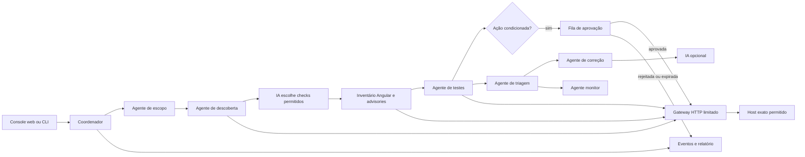

# Pentest com agentes — Hackathon Hubbits, Desafio 3

Pipeline funcional e limitada para receber uma URL HTTPS autorizada, identificar o framework, testar superfícies públicas, registrar evidências, sugerir correções e detectar regressões. O escopo padrão está em [`scope.json`](scope.json): até **11 requisições GET/HEAD**, intervalo mínimo de 1 segundo, até três bundles JavaScript e 512 KiB por resposta. O fragmento `#/` é rota de navegador e não integra a requisição HTTP.

Veja o [plano das oito funcionalidades](docs/PLANO_FUNCIONALIDADES.md) e os [resultados controlados de 12/11/2026](docs/RESULTADOS_2026-11-12.md), com provas, limites e captura direta vinculada apenas à listagem de `/ftp/`.

## Executar

Requer Python 3.11 ou superior; não há dependências Python obrigatórias.

```bash
python3 -m pentest_pipeline scan --config scope.json
python3 -m pentest_pipeline scan --config scope.json --target 'https://4.migbot.com.br//#/tokensale-ico-ea'
python3 -m pentest_pipeline scan --config scope.json --approve-quoted-search
python3 -m pentest_pipeline monitor --config scope.json --baseline reports/baseline.json
python3 -m pentest_pipeline.web_server
python3 -m unittest discover -s tests -v
```

O comando `scan` grava `evidence.json` e `report.md` em `reports/<run_id>/`. `monitor` cria o baseline na primeira execução e, nas seguintes, grava `diff.json` com achados novos, resolvidos, alterados e estáveis. Retorna código 2 quando há achado novo ou alterado; execução incompleta não é comparada nem substitui o baseline. Use `--update-baseline` somente depois de revisar o diff. `Ctrl+C` solicita parada; o evento de parada fica na trilha de auditoria. O par sintético de busca requer `--approve-quoted-search` no CLI; sem isso, o check é pulado e a cobertura fica inconclusiva.
O monitor compara apenas execuções com o mesmo alvo, configuração de escopo e hash das regras de teste. Uma mudança no detector exige novo baseline revisado; não é interpretada como mudança no alvo.

A interface web local abre com `python3 -m pentest_pipeline.web_server`. Informe a URL HTTPS pública, confirme que tem autorização para testá-la e insira a chave OpenAI para a campanha. Se `OPENAI_API_KEY` já estiver no ambiente do servidor, o campo pode ficar vazio. A chave é usada em memória e não entra no relatório, nos eventos ou no Git. A interface permite acompanhar o plano dos agentes, decidir a única ação condicionada declarada, parar a campanha e baixar o relatório. A fila de aprovação expira em cinco minutos; rejeição, expiração e interrupção não executam o par de busca. Cada requisição ainda passa pelas regras de escopo e volume.

Para URLs fora do laboratório `4.migbot.com.br`, a pipeline limita os testes a inventário de framework, cabeçalhos, cookies, `robots.txt` e `security.txt`. Checks próprios do Juice Shop só são habilitados para o host exato. Fragmentos SPA são aceitos para navegação, mas removidos antes de qualquer requisição. URLs com credenciais, query, host privado ou esquema diferente de HTTPS são recusadas.

### Orientação opcional por IA

```bash
export OPENAI_API_KEY="..."
export PENTEST_AI_MODEL="gpt-6-luna"  # opcional; este é o padrão
python3 -m pentest_pipeline scan --config scope.json --ai
# Para incluir o par sintético de busca no CLI, acrescente --approve-quoted-search.
```

`OpenAIPlanner` seleciona até quatro checks opcionais de uma lista fixa após o GET inicial. `OpenAIAdvisor` oferece dicas para os achados. Ambos usam a [Responses API](https://developers.openai.com/api/docs/guides/migrate-to-responses?api-mode=responses), `store: false` e saída JSON estruturada. O planejador recebe só origem e metadados HTTP sanitizados; o orientador recebe IDs, classificações e evidências resumidas de até cinco achados. Corpos do site, bundles, valores de cookies e arquivos não são enviados. O modelo não recebe ferramentas de rede, não altera a severidade e não decide se uma CVE está confirmada. Se a IA falhar, o executor usa o perfil seguro e registra a falha sem expor a chave. `.env` e `reports/` são ignorados pelo Git.

O inventário Angular lê, sem executar, até três JavaScripts públicos referenciados pelo HTML e procura um marcador de versão específico. Compara a versão a um catálogo **limitado** de advisories oficiais datado de 12/11/2026. Um CVE só é exibido como possível quando o pacote e a faixa de versão coincidem; exploração exige ainda verificar o código e as condições do aviso. Sem versão exata ou pacote confirmado, o resultado permanece inconclusivo. No alvo, o bundle indica Angular 22.2.2; não há CVE confirmada. Veja [a avaliação Angular](docs/ANGULAR_CVES.md).

## Agentes e dados



| Agente | Trabalho executável |
| --- | --- |
| Escopo | Valida host, esquema, porta, método, caminhos, ritmo e orçamento antes da campanha. |
| Descoberta | Lê a página inicial, até três bundles JavaScript e conta desafios de dificuldades 1 e 2 em `/api/Challenges` no host do laboratório. |
| Inventário Angular | Identifica família e versão por marcadores específicos e cruza avisos do mantenedor sem inferir exploração. |
| Planejamento por IA | Seleciona somente IDs opcionais permitidos; cabeçalhos, cookies e inventário sempre executam. |
| Testes | Confere cabeçalhos e cookies; lê somente índices de `/ftp/`, formato de `/metrics` e compara `q=apple` com `q=apple%27` na busca. |
| Triagem | Deduplica e atribui severidade, estado e confiança a cada evidência. |
| Correção | Anexa dicas condicionais de configuração e código; não presume acesso ao repositório da aplicação. |
| Monitor | Compara duas execuções completas por identificador estável de achado. |

O site alvo é uma SPA; os arquivos desta pasta implementam o **avaliador**, não o código da aplicação avaliada. Por isso, as sugestões Express/SQLite são exemplos baseados no erro observado e precisam ser adaptadas ao servidor real.

## Modelo de segurança

- O transporte central aceita apenas `GET` e `HEAD`, valida host exato, HTTPS e porta, bloqueia endereços privados por padrão e **não segue redirecionamentos**. Scripts de outros hosts são recusados. A campanha não baixa arquivos listados em `/ftp/`; verifica por `HEAD` somente os nomes previstos e realmente anunciados pelo índice.
- A fila executa somente checks declarados. Não há força bruta, exploração SQL, injeção adicional, exfiltração, alteração de estado ou aumento automático de profundidade. Credenciais privilegiadas e ações ativas exigem aprovação humana e implementação específica.
- O limite de requisições, o intervalo, o timeout e o teto de corpo estão em `scope.json`. Corpos são analisados em memória e descartados; o log guarda status, metadados limitados e hash SHA-256. URLs são registradas sem query e valores de cookies não são persistidos. A evidência cita somente os dois valores sintéticos usados no teste de busca.
- Cada decisão, requisição, resposta, teste, classificação, orientação e parada produz evento com horário UTC. Estados dos achados: `confirmed` para observação reproduzida, `inconclusive` para sinal que precisa de contexto e `discarded` quando uma hipótese for examinada e refutada. Se faltar cobertura de um teste declarado, a campanha fica `inconclusive`; o monitor só compara campanhas `completed`.
- Ausência de cabeçalho indica configuração a revisar, não prova exploração. A diferença 200/500 com `SQLITE_ERROR` indica erro SQL exposto e entrada mal tratada; não comprova extração, bypass ou SQL injection explorável.
- Respostas HTTP e JavaScript do alvo são dados não confiáveis: não viram instruções para a IA ou para o executor. Evidência de diretório requer marcador de índice e MIME HTML; métricas exigem formato Prometheus; `HEAD 403` não vira vazamento. Conteúdo de SPA que responde 200 em qualquer rota fica inconclusivo quando faltam os marcadores esperados. Consulte [a análise de `/ftp`](docs/FTP_ANALISE.md) e [a avaliação de prompt injection](docs/PROMPT_INJECTION.md).

## API para integração

```python
from threading import Event
from pentest_pipeline import ScopeConfig, run_scan, render_markdown, compare_runs

config = ScopeConfig.from_file("scope.json")
stop_event = Event()
result = run_scan(config, stop_event=stop_event, on_event=lambda event: print(event))
snapshot = result.to_dict()  # JSON serializável; run_scan não grava arquivos
markdown = render_markdown(result)
```

O evento tem `timestamp`, `type`, `phase` e `message`, além de metadados seguros para a fase. `result` contém `run_id`, `status`, `stop_reason`, `findings`, `observations`, `recommendations`, `actions` e `summary`. Cada achado inclui trecho sanitizado, prova, limite, reprodução controlada e, quando houver captura direta pertinente, caminho local e hash da imagem. O plano por etapa registra hipótese, ação, resultado esperado e condição de parada antes do check.
