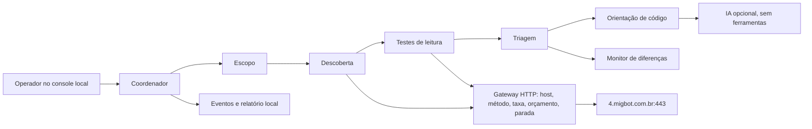

# Avaliação inicial e plano de correção — Desafio 3

- **Alvo informado pelo usuário:** `https://4.migbot.com.br/#/`
- **Data da campanha final:** 12/11/2026, 09:55 (America/Recife)
- **Evidência publicada:** [`resultado-inicial.json`](resultado-inicial.json) e [`resultado-inicial.md`](resultado-inicial.md)
- **Estado:** campanha encerrada conforme o plano; 6 GETs; 6 observações confirmadas; 5 sugestões adicionais da IA.

## Resumo executivo

A aplicação se identifica como **OWASP Juice Shop**, um laboratório deliberadamente vulnerável. A campanha verificou somente a origem HTTPS fornecida, sem autenticação, download de arquivos do índice, alteração de dados, força bruta ou exploração encadeada. Encontrou três exposições de prioridade média e três ajustes de cabeçalhos de prioridade baixa. As severidades representam a evidência observada nesta instância; o impacto de acessar conteúdo de arquivos, modificar consultas ou acessar dados de outros usuários não foi testado.

| Prioridade | Observação confirmada | Evidência mínima | Próxima correção |
| --- | --- | --- | --- |
| P1 · média | `/ftp/` lista o diretório | `GET /ftp/` → 200, HTML de índice; nenhum arquivo foi aberto | Remover listagem, tirar artefatos do diretório público e restringir arquivos necessários |
| P1 · média | `/metrics` é público | `GET /metrics` → 200, formato Prometheus; valores não foram retidos | Restringir a rede de observabilidade ou exigir autenticação |
| P1 · média | Busca expõe erro SQLite | `q=apple` → 200; `q=apple%27` → 500 com `SQLITE_ERROR` | Parametrizar a consulta e devolver erro genérico ao cliente |
| P2 · baixa | CSP ausente | Resposta da página inicial sem `Content-Security-Policy` | Mapear origens e testar CSP em `Report-Only` antes de aplicar |
| P2 · baixa | HSTS ausente | Resposta da página inicial sem `Strict-Transport-Security` | Habilitar após validar HTTPS em todas as rotas e subdomínios pertinentes |
| P2 · baixa | Política de Referer ausente | Resposta da página inicial sem `Referrer-Policy` | Definir política adequada aos fluxos da SPA |

Todos os seis achados têm confiança **alta na observação**. O erro SQLite comprova divulgação de detalhe interno e uma entrada que causa erro, **não** extração de dados ou SQL injection explorável. A listagem comprova nomes visíveis, **não** acesso ao conteúdo. O monitor distingue esses limites no relatório. A [OWASP recomenda](https://cheatsheetseries.owasp.org/cheatsheets/SQL_Injection_Prevention_Cheat_Sheet) consultas parametrizadas; seu [guia de testes](https://wstg.owasp.org/latest/4-Web_Application_Security_Testing/08-Error_Handling/01-Improper_Error_Handling/) descreve o risco de erros detalhados. A [documentação do Prometheus](https://prometheus.io/docs/operating/security/) recomenda proteger endpoints de métricas de redes públicas.

A [análise aprofundada de `/ftp`](FTP_ANALISE.md) separa a listagem confirmada do acesso direto a arquivos: `HEAD` de um `.kdbx` retornou 200, enquanto dois backups `.bak` retornaram 403. O conteúdo e a presença de credenciais não foram verificados.

Depois desta campanha inicial, a pipeline passou a inventariar bundles Angular e verificar metadados de arquivos listados por `HEAD`, com teto de 11 requisições. A [nova execução na rota Token Sale](ANGULAR_CVES.md) identificou Angular 22.2.2; nenhum CVE foi confirmado. A [revisão de prompt injection](PROMPT_INJECTION.md) também permaneceu inconclusiva porque o chat de IA retornou indisponibilidade.

## Dificuldades básicas do laboratório

O catálogo público de `/api/Challenges` retornou **13 desafios de dificuldade 1** e **19 de dificuldade 2**. A ordem inicial indicada por `tutorialOrder` começa com **Score Board, DOM XSS, Bonus Payload, Privacy Policy, Reflected XSS** e **Exposed Credentials**. Isso é um mapa de aprendizagem, não uma lista de desafios resolvidos. Os testes desta campanha ficaram nas exposições públicas e em um par de entradas de busca não destrutivo; XSS, autenticação, autorização de cestas e credenciais ficaram fora da execução automática.

## Dicas de código e validação

O repositório desta entrega contém o **avaliador**, não o código-fonte da aplicação. Os exemplos abaixo devem ser adaptados ao driver, proxy e fluxo de autenticação usados no servidor real.

### Busca e erro SQL

```js
// Exemplo para um driver SQLite com parâmetros posicionais.
const term = `%${String(req.query.q ?? '').slice(0, 100)}%`;
const rows = db.prepare('SELECT id, name FROM Products WHERE name LIKE ?').all(term);
res.json(rows);

// Em um tratamento central de erros, mantenha o detalhe em logs protegidos.
app.use((err, req, res, next) => {
  logger.error({ err, requestId: req.id });
  res.status(500).json({ error: 'internal_error', requestId: req.id });
});
```

Teste de regressão: a busca simples e a busca com aspa não devem incluir `SQLITE_ERROR` na resposta; resultados esperados devem continuar corretos. Revise também a consulta no código para confirmar o uso de parâmetros. Validação de entrada complementa, mas não substitui parâmetros SQL.

### Índice e métricas

Remova `serve-index` ou configuração equivalente do caminho `/ftp/`; no proxy, desative `autoindex` e mantenha backups, configurações e material operacional fora da raiz pública. Para `/metrics`, use uma rota interna de observabilidade ou controle de acesso na borda, com credenciais separadas das contas da aplicação. Regra de regressão: requisição anônima de fora da rede confiável deve receber 403/404; o coletor autorizado deve continuar funcionando. A [OWASP WSTG](https://wstg.owasp.org/latest/4-Web_Application_Security_Testing/02-Configuration_and_Deployment_Management/04-Review_Old_Backup_and_Unreferenced_Files_for_Sensitive_Information/) recomenda impedir listagem e acesso público a artefatos sensíveis.

### Cabeçalhos

Configure CSP primeiro em modo de relatório para medir dependências da SPA, depois aplique uma política testada. Envie HSTS somente após validar o domínio em HTTPS. Defina `Referrer-Policy`, por exemplo `strict-origin-when-cross-origin`, conforme os fluxos. A [OWASP HTTP Headers Cheat Sheet](https://cheatsheetseries.owasp.org/cheatsheets/HTTP_Headers_Cheat_Sheet.html) traz orientações de configuração.

## Arquitetura e modelo de segurança



O gateway é a única peça que faz requisições. O escopo fixa host, esquema, porta e métodos `GET/HEAD`; o padrão é **6 requisições planejadas**, teto de **8**, intervalo mínimo de **1 s**, limite de corpo e redirecionamentos desligados. O botão de parada sinaliza o executor e a campanha conserva as ações já registradas. A IA recebeu somente achados resumidos e sem corpos; não recebeu ferramenta de rede nem decidiu a severidade. Nesta campanha, `gpt-6-luna` retornou cinco sugestões para revisão humana. `scope.json` pode ser revisado antes de qualquer nova campanha.

O monitor só compara campanhas completas com mesmo alvo, escopo e hash das regras. Uma alteração no detector exige novo baseline revisado. A comparação visual feita durante o desenvolvimento marcou `/ftp/` como “novo” porque o detector passou a reconhecer o título real do índice; isso **não demonstra mudança no alvo**. O baseline local final é uma cópia integral da [execução publicada](resultado-inicial.json) e fica em `reports/baseline.json`, fora do Git.

## Limites e evolução

Não há código do alvo para corrigir nesta pasta. Não foram testados autenticação, IDOR, XSS, CSRF, upload, acesso a arquivos listados, exfiltração nem impacto da falha SQL. O PDF do desafio coloca credenciais privilegiadas, alterações de estado, maior intensidade e exploração encadeada sob aprovação humana; o MVP não implementa esses executores. A fila da interface informa que não há ações pendentes. O console está vinculado a `127.0.0.1` e deve ser usado localmente.

| Prazo | Evolução proposta | Critério de pronto |
| --- | --- | --- |
| Mês 1 | Revisar os seis achados com a equipe do alvo e aplicar correções de exposição | Regressões anonimizadas passam; relatório de rechecagem disponível |
| Mês 2 | Adicionar contas sintéticas e escopo por rota para testes de autorização | Aprovações e identidades de teste registradas; nenhum dado real usado |
| Mês 3 | Implementar fila de aprovação para testes ativos específicos | Ação só inicia após aprovação explícita, com expiração e trilha |
| Mês 4 | Integrar revisão de código e testes de segurança no CI | Achado vinculado a arquivo, correção e teste de regressão |
| Mês 5 | Adicionar alertas por mudança de baseline e histórico de campanhas | Falhas de cobertura não são classificadas como “resolvidas” |
| Mês 6 | Avaliar o sistema em ambiente isolado com equipe humana | Métricas de falso positivo, tempo de correção e parada comprovadas |

## Demonstração de até cinco minutos

1. Mostrar o escopo fixo e o orçamento em `scope.json`.
2. Iniciar a campanha pelo console e acompanhar requisição, evidência e classificação na trilha.
3. Mostrar os seis achados, as dicas de código e as contagens de dificuldades 1/2.
4. Demonstrar a interrupção **em servidor local de teste**, para evitar uma campanha extra no alvo ao vivo.
5. Abrir `report.md`, `evidence.json` e explicar o baseline e os limites da IA opcional.
